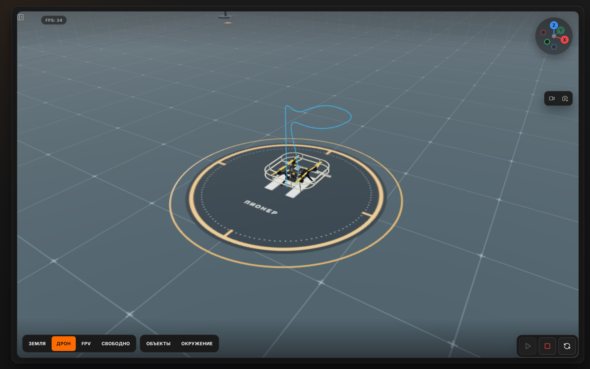
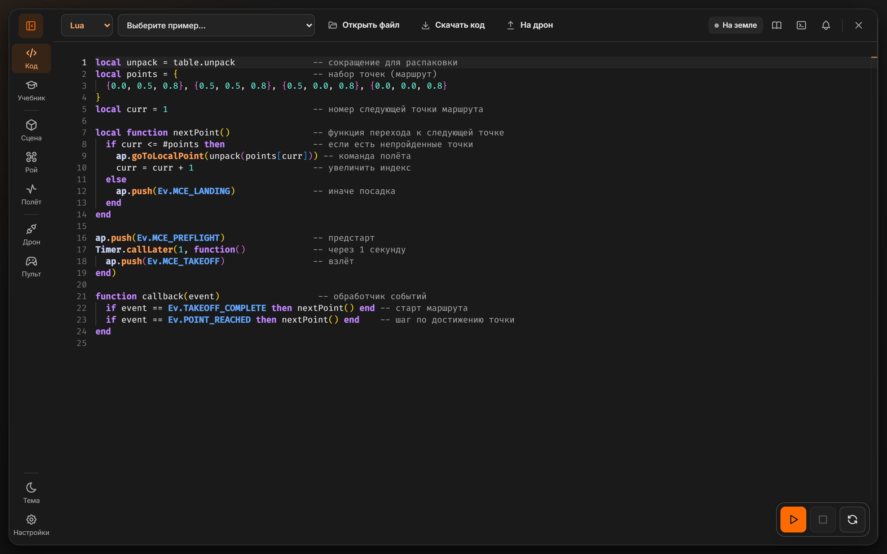
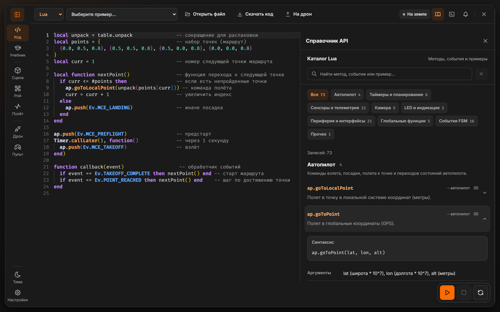
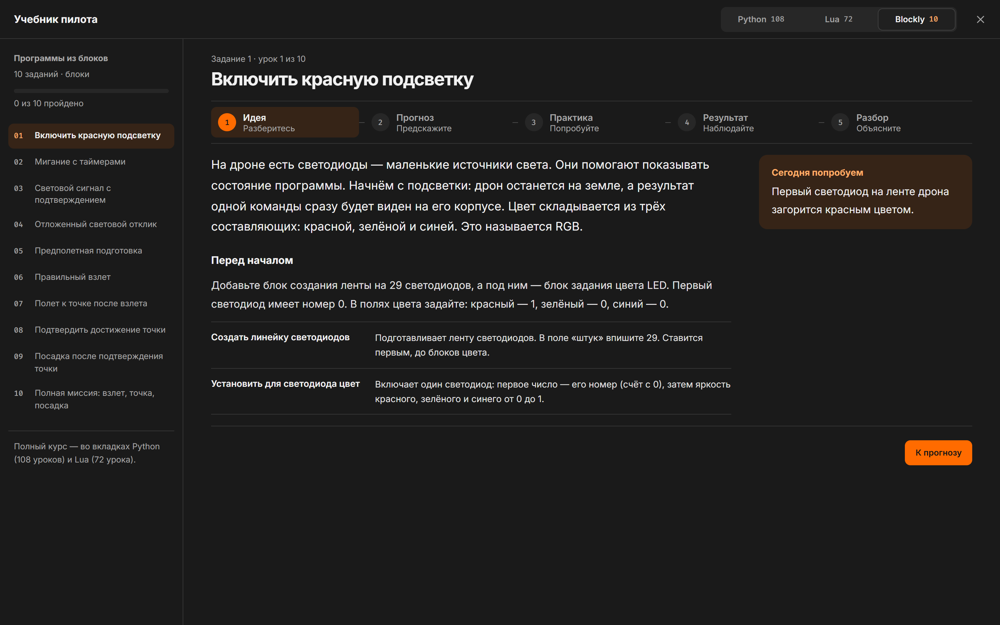
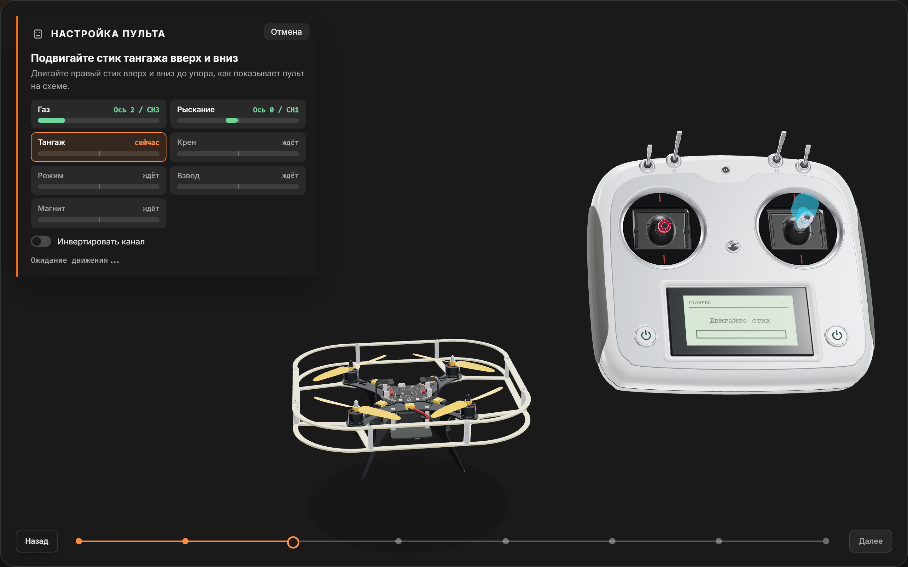
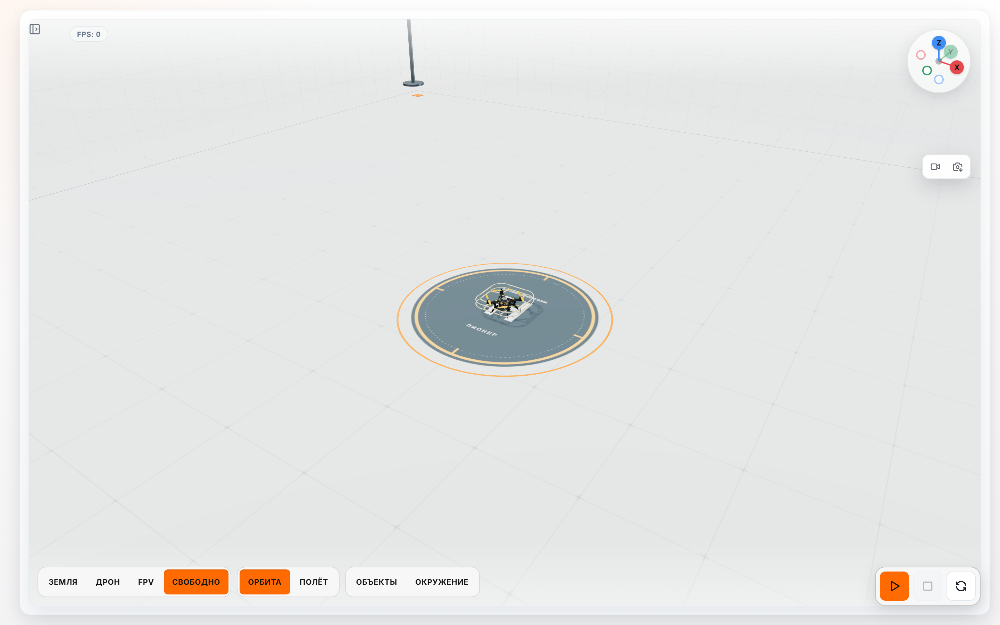

<div align="center">



# 🚁 Программные средства БПЛА

**Курс по программированию дронов «Геоскан Пионер»: учебник, веб-симулятор с интерактивной Академией (230+ уроков с проверкой полётом), кабинеты учителя и ученика и 300+ проверенных примеров на Lua, Python и Blockly**

[🎮 Запустить симулятор](https://simulator.sakoryagin.ru) · [📖 Учебник (PDF)](./book/main.pdf) · [🌐 sakoryagin.ru](https://sakoryagin.ru)

</div>

---

> 👨‍🏫 **Автор курса и материалов:** Корягин Сергей Андреевич
> 🌐 **Сайт автора:** [sakoryagin.ru](https://sakoryagin.ru)

Репозиторий собирает всё, чтобы научить школьника или студента писать программы для настоящего квадрокоптера и **не разбить его при первом запуске**: методичку, песочницу с физикой дрона и примеры, каждый из которых прогоняется автоматическими тестами.

## ✨ Что внутри

| | |
|---|---|
| 📖 **Учебник** | LaTeX-книга в три части: Lua, Python, навигация. Скриншоты симулятора показывают, где писать код и что получится. |
| 🎓 **Академия в симуляторе** | Режим обучения: 124 урока Python, 93 урока Lua и 16 уроков Blockly. У каждого урока есть объяснение «как это устроено», задание с пропуском в коде и проверка настоящим полётом, а не сравнением текста. |
| 🎮 **Веб-симулятор** | Дрон, физика, карты до 600 м с городом, лесом, холмами, рекой и поездами, камеры, FPV, редактор с подсказками, терминал, Blockly. Работает в браузере, ничего ставить не нужно. |
| 👩‍🏫 **Кабинеты учителя и ученика** | Аккаунты, классы, таблица «ученик × миссия», ручной зачёт с комментарием, отчёт CSV, история попыток с кодом и сводка «где застревают». Ученик видит прогресс, серию дней и достижения. |
| 🧪 **Примеры** | Более 250 скриптов на Lua и Python и 50 блочных программ: светодиоды, датчики, пульт, миссии, рой, машинное зрение. Тест запускает каждый и проверяет, что дрон взлетает, долетает и садится. |
| 📚 **Справочник API** | Около 140 записей по Lua API и `pioneer_sdk`: синтаксис, параметры, единицы измерения, пометки «→ автопилот» и «← от автопилота», примеры, которые проверяются тестами. |
| 🔌 **Реальный дрон** | Из симулятора можно загрузить Lua-программу на настоящий Пионер по USB (Web Serial) и смотреть его телеметрию. Внешний `pioneer_sdk` подключается к симулятору по HTTPS и MAVLink. |

## 🖼️ Как это выглядит

### Пишем код и сразу видим полёт



Редактор на Monaco: подсказки по функциям Пионера, подсказки по аргументам при наборе скобки, русские псевдонимы в автодополнении, проблемы и вывод в терминале.

### Справочник API под рукой



Около 140 записей по категориям: синтаксис, аргументы, единицы измерения, возвращаемое значение и пример, который копируется одной кнопкой. У команд и событий автопилота есть явные пометки: **«→ автопилот»** (программа отправляет команду) и **«← от автопилота»** (событие приходит в `callback`). Справочник сверен с официальным `pioneer_sdk` и документацией Lua API, а примеры в нём разбираются и проверяются тестами.

### Учебник внутри симулятора



Урок разбит на пять шагов: идея, прогноз, практика, результат, разбор. Если в программе ошибка, симулятор не просто пишет «error»: объясняет по-человечески и ведёт на нужный урок.

### Академия: уроки с проверкой полётом

Режим обучения ведёт ученика по главам: от первой команды `arm` и светодиодов до таймеров, маршрутов, датчиков, камеры, ArUco-меток и самостоятельных миссий. В каждой миссии:

1. короткое объяснение «как это устроено»: что за устройство или метод, как задаются параметры (порядок аргументов, единицы, диапазоны), что будет видно в результате;
2. задание с шагами и пропуском `___` в готовой программе;
3. кнопка «Проверить полёт»: симулятор реально запускает программу и проверяет события, положение дрона, светодиоды и журнал, а не текст кода;
4. понятное замечание, если что-то не так, и подсказка по шагам.

Часть миссий состоит из нескольких опытов (например, сначала зелёный, потом синий): проверка запоминает подтверждённые опыты и говорит, какой запуск остался. Python-линия содержит 124 миссии (в том числе машинное зрение и наведение по метке), Lua-линия 93, Blockly 16.

### Кабинеты учителя и ученика

Без входа всё работает как раньше, прогресс остаётся в браузере. Для класса есть аккаунты:

* **Ученик** регистрируется сам. В «Моём кабинете»: карточка «Продолжить», прогресс по трём языкам, список миссий, история своих попыток с кодом, календарь активности, серия дней, достижения, профиль.
* **Учитель**: обзор класса (кто занимался, кто застрял, кто давно не заходил), группы, массовое создание учеников со случайными паролями, таблица «ученик × миссия», ручной зачёт с комментарием, отчёт CSV, страница ученика с историей попыток и кодом.
* **Где застревают**: миссии, где чаще всего не проходит проверка, с частыми замечаниями. Если много людей получают одно и то же замечание, формулировка задания написана непонятно.
* **Приватность**: код хранится только у учеников с аккаунтом, об этом сказано в окне входа. Анонимная метрика (без имён и кода) показывает, какие миссии чаще бросают.

Устройство, данные и развёртывание: [simulator/README.md](simulator/README.md) и [simulator/docs/cabinets.md](simulator/docs/cabinets.md).

### Настройка пульта, как в симуляторах FPV



Мастер показывает на 3D-пульте, что подвигать. Пользователь двигает, каналы определяются сами, а дрон тут же повторяет движение стиков: на малом газе пропеллеры едва вращаются, потом раскручиваются, и дрон взлетает.

### Светлая тема



## 🚀 Быстрый старт

Самый простой путь: открыть [simulator.sakoryagin.ru](https://simulator.sakoryagin.ru).

Локально (нужен Node.js 20+):

```bash
cd simulator
npm install
npm start          # сервер примеров + Vite на http://localhost:3011
```

Проверки:

```bash
npm run type-check                                  # TypeScript
npm test                                            # весь набор: 1700+ тестов
npm test -- tests/lessons-book-examples.test.ts     # все примеры книги в симуляторе
```

Часть тестов (генерация города, толпа людей) проверяет скорость и на загруженной машине может упасть по времени: перезапустите её отдельно.

Сборка учебника (TeX Live 2024+, XeLaTeX, biber, Python с `pygments`):

```bat
personal\lessons\build.bat
```

## 📂 Структура репозитория

```
├─ simulator/      веб-симулятор (TypeScript, Three.js, Monaco, Blockly) и его тесты
├─ book/           учебник: исходники LaTeX, данные для примеров навигации, сборка
├─ examples/       все примеры: единственный источник и для книги, и для симулятора
│  ├─ lua/         примеры глав по Lua (02_sensors, 03_rc_control, 04_language, 05_leds, 06_missions)
│  ├─ lua-tasks/   решения практических заданий
│  ├─ python/      скрипты на pioneer_sdk: камера, ArUco, рой, навигация
│  └─ python-answers/  ответы к упражнениям по Python
├─ third-party/    чужое, только для чтения
│  ├─ geoskan/     официальные материалы производителя
│  └─ web-docs/    сохранённые страницы: API Pioneer, пульт FlySky FS-i6S
├─ docs/           картинки для README и описание структуры
└─ archive/        устаревшее и черновики
```

Идея проста: **что запускаем** (`simulator`), **что читаем** (`book`), **чему учим** (`examples`), **чужое** (`third-party`). Подробности и история решений в [docs/repo-structure.md](docs/repo-structure.md).

## ⚖️ Авторство и лицензия

> ⚠️ **Внимание:** пожалуйста, соблюдайте условия использования материалов.

* 🎓 **Образовательное использование:** содержимое `simulator/`, `book/`, `examples/` и `archive/` принадлежит **Корягину С. А.** и свободно для использования в образовательных целях.
* 🔗 **Атрибуция:** при любом использовании, копировании или публикации материалов обязательна ссылка на автора и сайт [sakoryagin.ru](https://sakoryagin.ru).
* 📜 **Официальные материалы:** содержимое `third-party/geoskan/` принадлежит компании «Геоскан» и распространяется на её условиях. В сомнительных случаях руководствуйтесь лицензионными файлами в соответствующих каталогах.
* 🛩️ Трёхмерные модели дрона и пульта FlySky FS-i6S в симуляторе — авторская реконструкция по фотографиям, не чертежи производителя.
