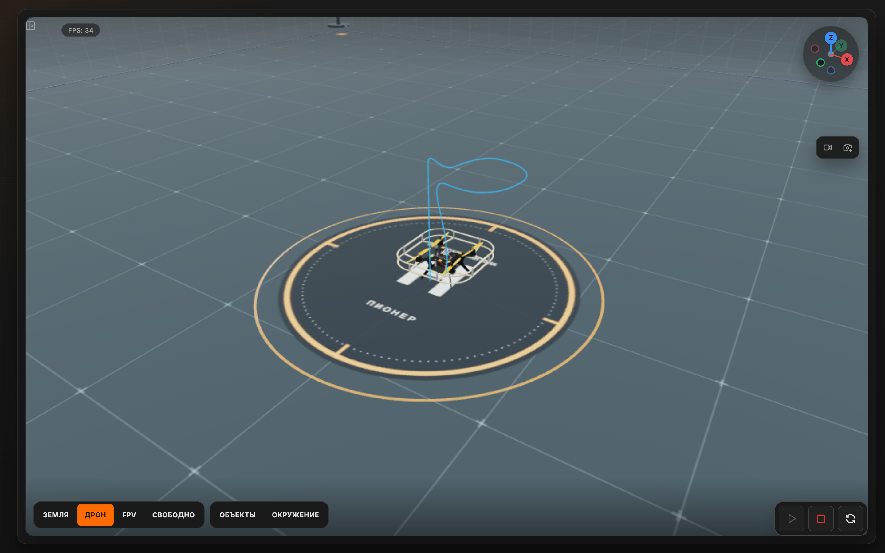
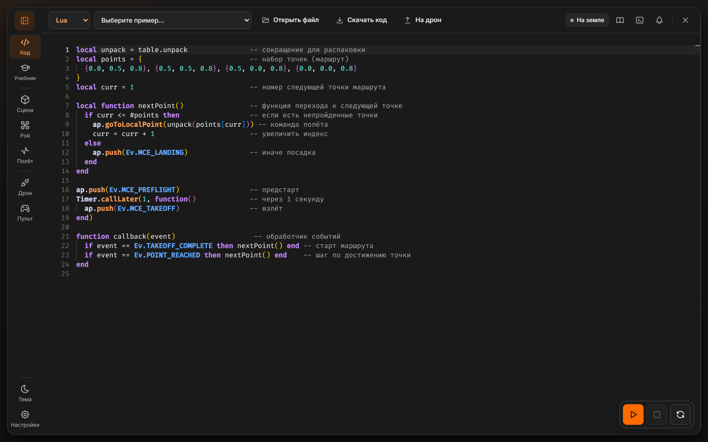
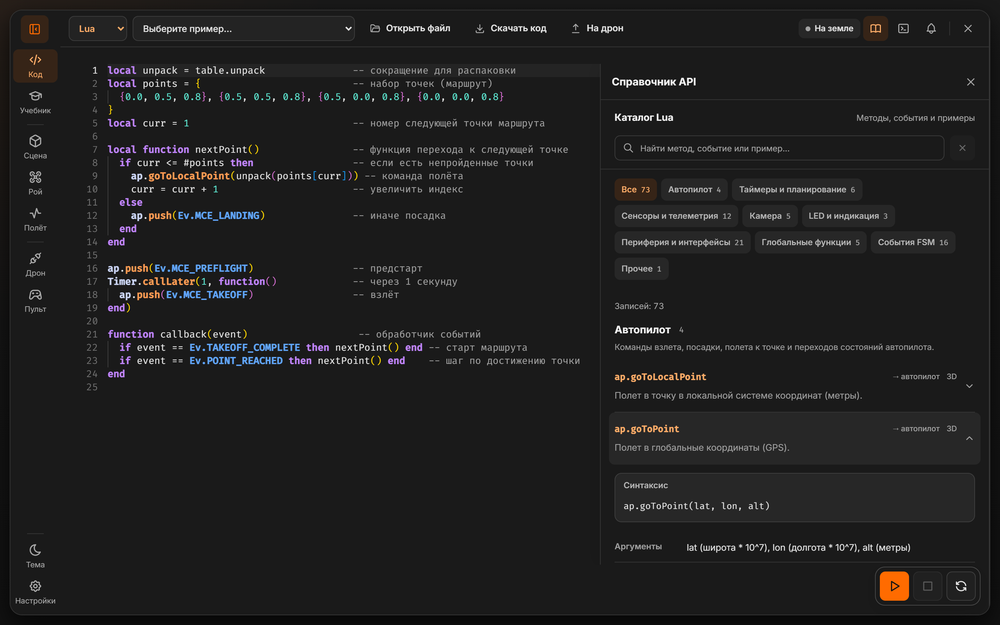
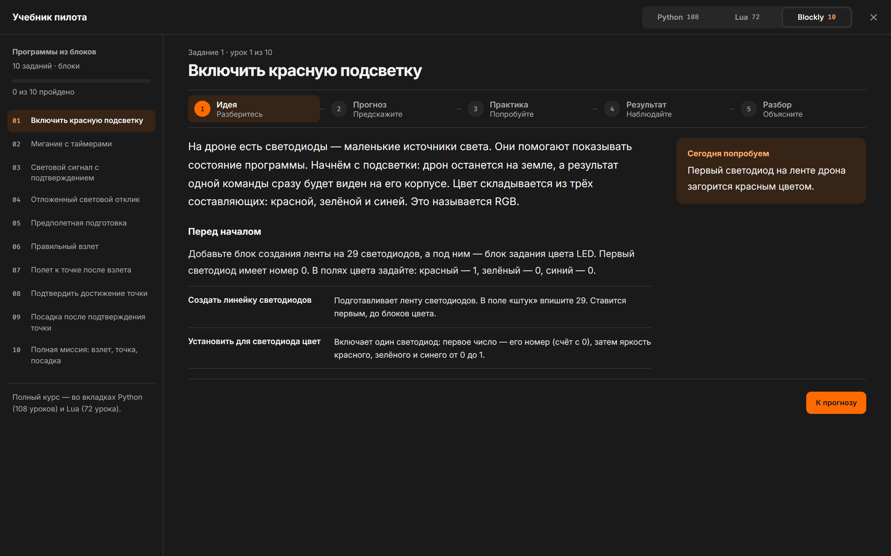
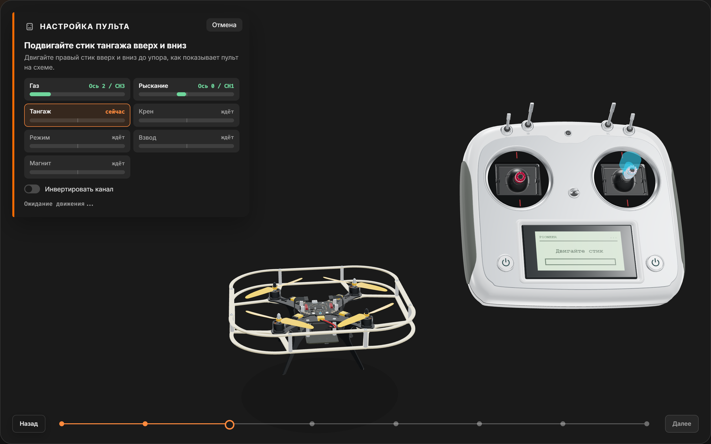
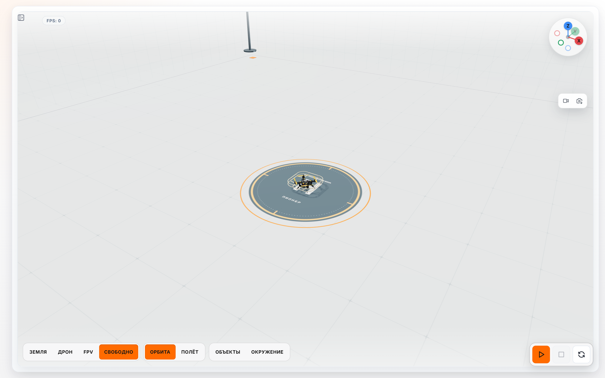

<div align="center">



# 🚁 Программные средства БПЛА

**Курс по программированию дронов «Геоскан Пионер»: учебник, веб-симулятор и 180+ проверенных примеров на Lua, Python и Blockly**

[🎮 Запустить симулятор](https://simulator.sakoryagin.ru) · [📖 Учебник (PDF)](./book/main.pdf) · [🌐 sakoryagin.ru](https://sakoryagin.ru)

</div>

---

> 👨‍🏫 **Автор курса и материалов:** Корягин Сергей Андреевич
> 🌐 **Сайт автора:** [sakoryagin.ru](https://sakoryagin.ru)

Репозиторий собирает всё, чтобы научить школьника или студента писать программы для настоящего квадрокоптера и **не разбить его при первом запуске**: методичку, песочницу с физикой дрона и примеры, каждый из которых прогоняется автоматическими тестами.

## ✨ Что внутри

| | |
|---|---|
| 📖 **Учебник** | LaTeX-книга в три части: Lua, Python, навигация. Скриншоты симулятора показывают, где писать код и что получится. |
| 🎮 **Веб-симулятор** | Дрон, физика, карты до 600 м, камеры, FPV, редактор с подсказками, терминал, Blockly. Работает в браузере, ничего ставить не нужно. |
| 🧪 **Примеры** | Скрипты по темам: светодиоды, датчики, пульт, миссии, рой, машинное зрение. Тест запускает каждый и проверяет, что дрон взлетает, долетает и садится. |
| 🔌 **Реальный дрон** | Из симулятора можно загрузить Lua-программу на настоящий Пионер по USB (Web Serial) и смотреть его телеметрию. |

## 🖼️ Как это выглядит

### Пишем код и сразу видим полёт



Редактор на Monaco: подсказки по функциям Пионера, подсказки по аргументам при наборе скобки, русские псевдонимы в автодополнении, проблемы и вывод в терминале.

### Справочник API под рукой



73 записи по категориям: синтаксис, аргументы, возвращаемое значение и пример, который копируется одной кнопкой.

### Учебник внутри симулятора



Урок разбит на пять шагов: идея, прогноз, практика, результат, разбор. Если в программе ошибка, симулятор не просто пишет «error»: объясняет по-человечески и ведёт на нужный урок.

### Настройка пульта, как в симуляторах FPV



Мастер показывает на 3D-пульте, что подвигать. Пользователь двигает, каналы определяются сами, а дрон тут же повторяет движение стиков: на малом газе пропеллеры едва вращаются, потом раскручиваются, и дрон взлетает.

### Светлая тема



## 🚀 Быстрый старт

Самый простой путь: открыть [simulator.sakoryagin.ru](https://simulator.sakoryagin.ru).

Локально (нужен Node.js 20+):

```bash
cd simulator
npm install
npm start          # сервер примеров + Vite на http://localhost:3011
```

Проверки:

```bash
npm run type-check                                  # TypeScript
npm test -- tests/lessons-book-examples.test.ts     # все примеры книги в симуляторе
```

Сборка учебника (TeX Live 2024+, XeLaTeX, biber, Python с `pygments`):

```bat
personal\lessons\build.bat
```

## 📂 Структура репозитория

```
├─ simulator/      веб-симулятор (TypeScript, Three.js, Monaco, Blockly) и его тесты
├─ book/           учебник: исходники LaTeX, данные для примеров навигации, сборка
├─ examples/       все примеры: единственный источник и для книги, и для симулятора
│  ├─ lua/         примеры глав по Lua (02_sensors, 04_language, 05_leds, 06_missions)
│  ├─ lua-tasks/   решения практических заданий
│  ├─ python/      скрипты на pioneer_sdk: камера, ArUco, рой, навигация
│  └─ python-answers/  ответы к упражнениям по Python
├─ third-party/    чужое, только для чтения
│  ├─ geoskan/     официальные материалы производителя
│  └─ web-docs/    сохранённые страницы: API Pioneer, пульт FlySky FS-i6S
├─ docs/           картинки для README и описание структуры
└─ archive/        устаревшее и черновики
```

Идея проста: **что запускаем** (`simulator`), **что читаем** (`book`), **чему учим** (`examples`), **чужое** (`third-party`). Подробности и история решений в [docs/repo-structure.md](docs/repo-structure.md).

## ⚖️ Авторство и лицензия

> ⚠️ **Внимание:** пожалуйста, соблюдайте условия использования материалов.

* 🎓 **Образовательное использование:** содержимое `simulator/`, `book/`, `examples/` и `archive/` принадлежит **Корягину С. А.** и свободно для использования в образовательных целях.
* 🔗 **Атрибуция:** при любом использовании, копировании или публикации материалов обязательна ссылка на автора и сайт [sakoryagin.ru](https://sakoryagin.ru).
* 📜 **Официальные материалы:** содержимое `third-party/geoskan/` принадлежит компании «Геоскан» и распространяется на её условиях. В сомнительных случаях руководствуйтесь лицензионными файлами в соответствующих каталогах.
* 🛩️ Трёхмерные модели дрона и пульта FlySky FS-i6S в симуляторе — авторская реконструкция по фотографиям, не чертежи производителя.
